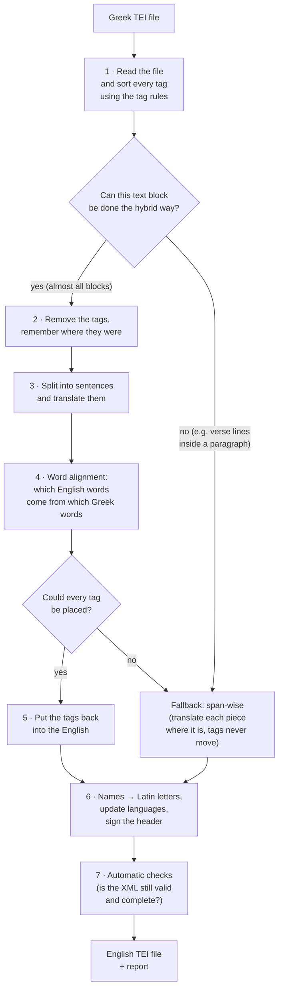
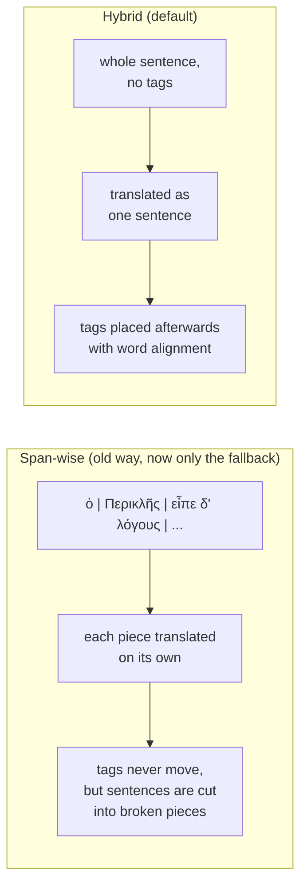
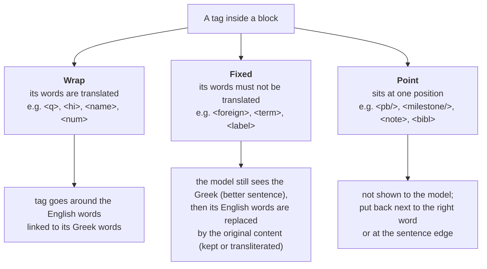
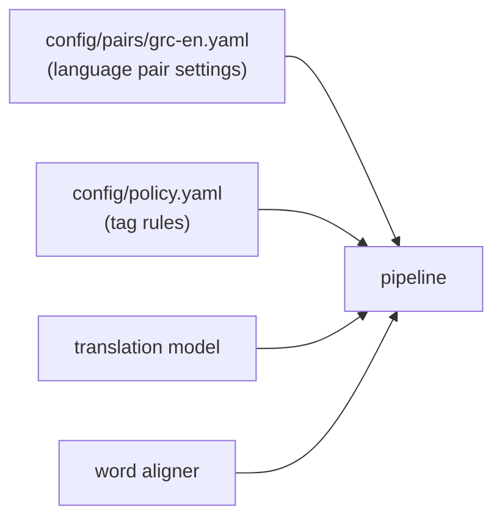

# How tei-translate translates a TEI file

A plain-language overview of the pipeline as it is now (November 2026), with the
default settings: **hybrid** tag placement. It is meant for the team, not as a code
reference. For the details see `CLAUDE.md` and the code in `src/tei_translate/`.

The diagrams use Mermaid: they render on GitHub and in VS Code's Markdown preview.

---

## 1. The problem in one picture

A TEI file is Greek text with XML tags inside it. A translation model only
understands plain text, and if we gave it the tags it would break or lose them. So
we have to take the tags out, translate, and put every tag back in the right place in
the English, which has a different word order.

```xml
<!-- Greek input -->
<p>ὁ <name type="person">Περικλῆς</name> εἶπε <num>δʹ</num> λόγους τοῖς
   <name type="ethnic">Ἀθηναίοις</name> καὶ ἀπῆλθεν.</p>

<!-- English output (what we want) -->
<p><name type="person">Pericles</name> gave <num>four</num> speeches to the
   <name type="ethnic">Athenians</name> and left.</p>
```

(Names and numbers are translated by the model, like normal text; section 3 has the
rules for every tag.)

**The main rule of the project:** the translation model never sees any XML. All the
structure comes from the original file and is put back by our code, never written by
a model.

---

## 2. The whole journey of a file



Each step in plain words:

1. **Read and sort.** The file is read and every element is looked up in the tag
   rules (`config/policy.yaml`, see section 3). The header (`teiHeader`) is never
   touched.
2. **Remove the tags.** Each text block (a paragraph `<p>`, a verse line `<l>`, a
   heading ...) becomes plain Greek text. For every tag we remember where it was.
3. **Translate.** The plain text is cut into sentences. All sentences of the whole
   file go to the translation model in one go.
4. **Align.** A second model (a *word aligner*, by default UGARIT, made for Ancient
   Greek and English) links each Greek word to the English word(s) that translate it.
   This is only needed for sentences that have a tag in the middle.
5. **Put the tags back.** Using those links, each tag is put around (or next to) the
   English words that correspond to its Greek words.
6. **Finish.** Names get written in Latin letters, `xml:lang="grc"` becomes `"en"`
   where the text is now English, and a line is added to the header saying which
   model did the translation.
7. **Check.** The output is compared with the input: is it valid XML, are all tags
   still there under the same parents, are protected parts unchanged, is the header
   unchanged, is it valid TEI (the official `tei_all` schema, TEI P5 4.12.0, stored
   in `config/schemas/`; a source file that is already invalid only fails if the
   output has *new* errors). The program prints a report and fails if a check fails.

---

## 3. The tag rules: what happens to each tag

All decisions about tags are written in **one file**, `config/policy.yaml`, which
follows the team's decisions in `docs/tag_decisions.md`. The code itself knows no tag
names, so changing how a tag is handled means editing that file, not the code.

Every tag gets a **role** (what kind of thing it is) and a **treatment** (what
happens to its text):

| Role | What it is | Examples |
|---|---|---|
| block | a unit of text that gets translated | `p`, `l`, `head`, `item`, `speaker` |
| container | groups other tags, has no text itself | `div`, `sp`, `lg`, `body` |
| inline | wraps a few words inside a block | `name`, `q`, `num`, `note` |
| empty | a marker with nothing inside | `pb`, `lb`, `milestone`, `gap` |

| Treatment | What happens | Tags |
|---|---|---|
| **translate** | text translated, tag kept around the English | `p`, `l`, `head`, `q`, `said`, `quote`, `hi`, `add`, `del`, `corr`, names (`name`, `persName`, `placeName`, `rs`), numbers (`num`) ... |
| **keep** | copied exactly, Greek included | `bibl` (references), `term`, `foreign`, empty markers |
| **transliterate** | written in Latin letters (ΣΩΚΡΑΤΗΣ → SOKRATES) | speaker labels: `speaker`, `label` |
| **keep whole** | the tag and everything inside copied unchanged | `note` (editors' notes, mostly Latin/English already) |

A tag that is not in the list is translated like normal text, kept in place, and
reported as "unknown" so we notice it.

**Names and numbers (changed 2026-11-20).** They used to be transliterated
(Περικλέους → *Perikleous*, with the Greek case ending) and kept (`δʹ`). Now the
model translates them, so the English shows *Pericles* and *four*. The old rules are
still in `policy.yaml` as comments, to switch back. One known problem: 93% of all
`<num>` tags are letters naming points and lines in Euclid's *Elements* (ΑΒ = "the
line AB"). The model copies most of them into Latin letters but makes mistakes (ΒΓΔ →
*BBD*, ΑΓΕ → *AE*, Γ sometimes *C* and sometimes *G*), which matters in geometry.

---

## 4. The hybrid approach, step by step

### Why "hybrid"

There were two ways to deal with tags:



- **Span-wise** is safe (every tag stays exactly where it was) but the model gets
  half-sentences, so the English comes out broken.
- **Hybrid** gives the model full sentences and then has to work out where each tag
  goes. It is the default; span-wise is used only where hybrid can't work.

### What happens to each kind of tag

When the tags are removed, each one is remembered as one of three kinds:



A worked example with the sentence from section 1 (the model output is made up to
show the steps, not a real run):

| Step | What we have |
|---|---|
| Input | `ὁ <name>Περικλῆς</name> εἶπε <num>δʹ</num> λόγους ...` |
| Tags removed (model input) | `ὁ Περικλῆς εἶπε δʹ λόγους τοῖς Ἀθηναίοις καὶ ἀπῆλθεν.` |
| Model output | `Pericles gave four speeches to the Athenians and left.` |
| Alignment | Περικλῆς ↔ *Pericles*, δʹ ↔ *four*, Ἀθηναίοις ↔ *Athenians*, ... |
| Tags placed | `<name>Pericles</name> gave <num>four</num> speeches to the <name type="ethnic">Athenians</name> and left.` |

All three tags here are *wrap* tags: each goes around the English words aligned to
its Greek words. A *fixed* tag works the same way, but then the model's English words
are swapped for the original content. For example, a `<foreign>` Latin word is put
back unchanged in place of whatever the model made of it.

### Where markers go

Empty markers and notes have no words of their own, so they need a rule for where
they land in the English. Between two sentences is easy: they stay between them.
Inside a sentence:

| Marker | Where it goes in the English | Why |
|---|---|---|
| `milestone` (section/line numbers) | before the English of the Greek word that followed it | scholars cite these numbers, so they should follow the words |
| `milestone unit="para"` | nearest sentence edge | 97% are already at a sentence end |
| `note`, `bibl`, `gap` | after the English of the Greek word before it | a note comments on the word before it |
| `pb`, `lb` (printed page/line) | nearest sentence edge | they mark the Greek book's layout, which has no exact place in English |

### When hybrid gives up: the fallback

Hybrid is not used, or gives up, for a block when:

- the block contains other blocks (e.g. a verse line `<l>` quoted inside a paragraph
  `<p>`). The inner `<l>` itself is still done the hybrid way;
- a tag's words cannot be aligned at all, or the aligned English is far too wide;
- tags would overlap in the English in a way XML does not allow.

Then the whole block is translated **span-wise** instead (each piece separately, tags
stay put). For markers the fallback is simply "nearest sentence edge". The report
counts how often and why this happened.

How often, on all 626 Greek files of Perseus: 217,573 blocks hybrid, 2,928 span-wise
(almost all because they contain other blocks). This test used a dummy model that
copies the text, so it shows the tag placement logic works, not that the alignment
is right with a real model.

---

## 5. The pieces you can swap



- **Translation model** (`--engine`):
  - `madlad-3b` (Google MADLAD-400, best so far, chrF 31.5): **the default**,
  - `pivot-grc-el-en` (Ancient Greek → Modern Greek → English, chrF 30.4, almost as good),
  - `opus-grk-en`, `opus-bible-ine` (small and fast, but much worse),
  - test engines `identity` (copies the Greek) and `tag` (marks text as `[EN:...]`).

  The default is set in `config/pairs/grc-en.yaml` (`engine: madlad-3b`, decided
  2026-11-20, for local runs and the HF Space; the pivot chain is the fallback).
  It needs the model extra (`pip install -e .[mt]`) and an 11.8 GB download on first
  use; `--engine identity` or `--engine tag` run without any model. See
  `docs/engine_comparison.md`.
- **Word aligner** (`--aligner`): `ugarit` (default), `dragoman`, `xlmr`, or `none`.
- **Placement** (`--placement`): `hybrid` (default) or `spanwise`.
- **Language pair**: the design does not assume Greek → English; another pair needs
  its own `config/pairs/` file (and a transliteration scheme for its script).

How to run it:

```powershell
python -m tei_translate translate IN.xml
```

This writes `outputs/<name>.en.xml` and prints the report.

### What the quality numbers say so far

- Plain-text translation (no tags): MADLAD 31.5 ≈ pivot chain 30.4 >> Opus models
  ~23 chrF, on 54 Perseus passages.
- Tags: on 16 prose passages whose sentences are cut by tags, hybrid scored 21.9
  chrF, span-wise 21.6, the same passages translated without tags 21.7. So the
  numbers are about the same, but hybrid avoids the broken sentences (see
  `docs/spanwise_cost.md`).
- What we **cannot** say yet: how often a tag ends up in the right place. That needs
  the gold set (section 6).

---

## 6. What is still to do

### Not built yet

| Item | Status / notes |
|---|---|
| **User interface** (Gradio `app.py`, local + Hugging Face Spaces) | decided, not started (`ui/` is empty). Also open: which language pairs to offer and how options appear in the UI |
| **Tag placement evaluation** | the scoring code exists (`metrics/scores.py`); the gold set of hand-checked English TEI files is in progress (`data/gold/grc-en/`, 8 Lucian works so far); not yet run on hybrid output |
| **Names and numbers handled by our own code** (not the model) | for now the model translates them (section 3). If that turns out unreliable: transliterate the dictionary form stored in each name's `key` attribute and/or use a name list; for numbers, a Greek-numeral parser plus Latin letters for Euclid's point labels |
| **COMET score** | planned in the proposal; only chrF and BLEU exist now |
| **TEI Schematron rules** | the `tei_all` check (built 2026-11-20) covers the RELAX NG grammar only; the extra Schematron rules inside the TEI schema are not run (would need an XSLT 2 processor) |
| **Fine-tuning a model** | in the original plan; nothing done, and it depends on hardware |
| **Error analysis** per tag type / per document, small human rating | proposed in the feedback, not done |
| **Speed** | MADLAD on a laptop CPU does ~5.5 Greek words per second: fine for passages, slow for whole works; the free HF Space has no GPU |

### Decisions the team still has to make

| Decision | Where it comes from |
|---|---|
| Confirm that names and numbers stay translated by the model (changed 2026-11-20); the gold set was made with the old rules (`<num>` kept in Greek) | `tag_decisions.md`, `gold_set_handover.md` |
| Which inline tag groups are officially in scope (editors' corrections?) | `tag_decisions.md` §5 |
| Position of empty markers: the current rules (section 4) are a proposal to confirm | `tag_decisions.md` §3 |
| `<del>` and `<choice>` handling | `HANDOVER.md` open questions |
| Hardware available (CPU only, GPU, Colab?) | `HANDOVER.md` |
| Extra features (e.g. linking Greek and English passages) | `HANDOVER.md` |
| Commit gold files one by one or only complete works? | `gold_set_handover.md` |

### Known weak spots

- **Alignment errors** are the main risk of hybrid: if the aligner links the wrong
  words, a tag lands in the wrong place, and the automatic checks won't notice
  (they check that tags are *there*, not that they are in the *right place*).
  Some tags (e.g. `<add>`) often fail to align and fall back to span-wise.
- **Verse**: translating line by line (each `<l>` separately) costs ~3 chrF, because
  a Greek sentence often runs over several lines.
- **Hard texts**: all models do badly on some authors (e.g. Josephus ~12 chrF) and
  the small Opus models repeat themselves on poetry like Homer.
